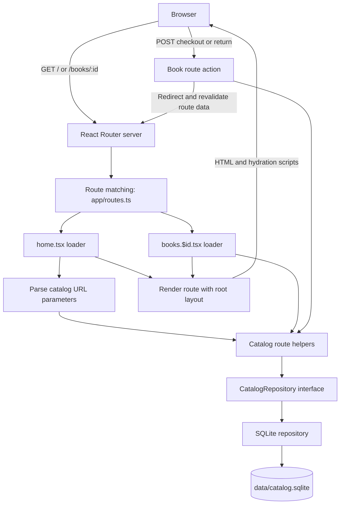

# Runtime architecture

This project uses **React Router framework mode with server-side rendering (SSR)**; it is not a Next.js application. Route loaders and actions form the backend-for-frontend (BFF), and there is no separate REST backend.

## Request and data flow

### Page loads

1. A request reaches the React Router server, which matches it using [`app/routes.ts`](../app/routes.ts).
2. The route's loader runs on the server. The catalog loader parses URL parameters; the detail loader resolves the book ID.
3. Route helpers call the [`CatalogRepository`](../app/catalog/repository.ts) interface. The SQLite implementation reads the catalog.
4. React Router renders the route with its loader data and the document shell from [`app/root.tsx`](../app/root.tsx), then sends HTML and hydration scripts to the browser.
5. After hydration, client-side navigation continues to use React Router's route data flow.

### Checkout and return

The detail page submits a POST form to its route action. The action delegates to the repository, which enforces the checkout/return rules and updates SQLite in a transaction. On success, the action redirects to the detail page and React Router reloads the route data. Business-rule failures are returned for inline display.

## Persistence

[`get-repository.ts`](../app/catalog/get-repository.ts) lazily creates the repository. [`db.ts`](../app/catalog/db.ts) opens `data/catalog.sqlite`; [`seed.ts`](../app/catalog/seed.ts) creates the table if necessary and inserts 200 synthetic books when the table is empty. The repository implementation is [`sqlite-repository.ts`](../app/catalog/sqlite-repository.ts).

**Implementation note:** [`schema.ts`](../app/catalog/schema.ts) declares a Drizzle schema, but the current repository and seed path use raw `better-sqlite3` SQL. Do not assume Drizzle is handling runtime persistence.

## Build and run

- `npm run dev` starts the React Router/Vite development server.
- `npm run build` creates the production client and server bundles.
- `npm run start` serves `build/server/index.js`.
- `npm run verify` runs typechecking, linting, and tests.

The canonical scripts are in [`package.json`](../package.json), and the production container build is in [`Dockerfile`](../Dockerfile).
